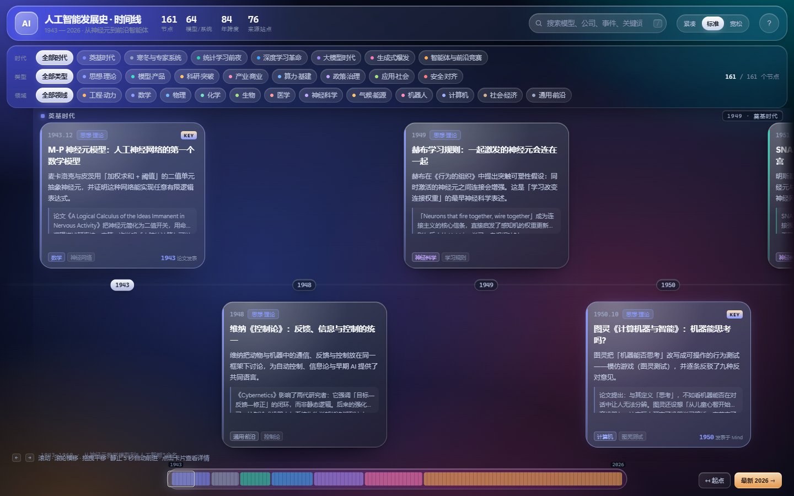

# AI 发展史横向时间线（1943—2026）

一条**从左到右**、可交互的人工智能发展史时间线。158 个有日期、有来源的精选节点，从 1943 年的 M-P 神经元，经过两次 AI 寒冬、深度学习、Transformer、ChatGPT，一直到 2026 年的前沿模型、长程智能体与 AI 科学家；并在其后持续自动收录新发布的信息。

**在线浏览：** <https://yyds25273.github.io/ai-evolution-timeline/>



## 亮点

- **158 个精选节点 / 7 个时代 / 8 种类型 / 12 个领域**，覆盖思想理论、模型产品、科研突破、产业商业、算力基建、政策治理、应用社会、安全对齐。
- **2025—2026 年 72 个节点（含自动收录）**：GPT-5.5、GPT-6 Astra、Gemini 4 Argon/Carbon、Claude Fable 5、Claude Opus 5、DeepSeek V4、Kimi K3、Qwen4-Max、GLM-5、Qwen3.5、Grok V9、Meta Muse 等。
- **可量化的结果**：企业 AI 支出 1768 亿美元（同比 5.4 倍）、智能体占 80% token、编码智能体让合并 PR +24%、AI 设计的噬菌体首次用于人体治疗、3.7 万智能体发现肺癌候选药、FDA 单月批准 24 个 AI 医疗器械。
- **你点名的节点**：OpenAI 于 2026 年 10 月 7 日公开 722 篇数学手稿——发布时为 722 篇 / 372 个成果族，后经撤回与修订，截至 2026-11-17 为 **721 篇 / 373 个成果族**，约 42% 的顶线结果有 Lean 形式化。
- **macOS Liquid Glass 视觉**：半透明毛玻璃、高光内边缘、极光背景与指针跟随高光；详情、筛选和迷你地图都做成悬浮玻璃层。

## 交互

- 横向滚动 / 滚轮横移 / 拖拽平移；`←` `→` 翻页，`/` 聚焦搜索。
- **静止 5 秒后自动从左向右匀速前进**；任何点击、滚轮、拖拽、键盘操作或打开详情都会立即暂停并重新计时，到达最新端后停止。
- 按**时代**、**类型**或**领域**筛选；三档密度：紧凑 / 标准 / 宽松。
- 领域包括数学、物理、化学、生物、医学、神经科学、气候·能源、工程·动力、机器人、计算机、社会·经济、通用·前沿；一条事件可属于多个领域。
- 底部迷你地图点击或拖动跳转；右上角实时显示「当前年份 · 所属时代」。
- 点击卡片打开详情抽屉：摘要、详细说明、关键数字、关键词、来源链接、前后节点导航。
- 卡片支持键盘聚焦，`Enter` 打开，`Esc` 关闭；地址栏会记录节点哈希，可直接分享。

## 数据说明

- **数据截止日：** 以页面「关于」与最新节点日期为准；最近一次人工核对为 **2026-11-17**。
- 横向轴是**顺序轴，不是等比时间轴**：每个节点等距排布，否则 2025—2026 年的信息密度会把前半屏挤成一条线。纵向交替只为容纳文字，不代表数值高低。
- 收录标准：有明确日期与可核查来源的开创性论文/系统、里程碑模型、可量化的产业与科研结果、改变规则的政策事件。未证实的传闻、纯营销口径、单一匿名来源的爆料不收。
- 来源分三级：官方公告（OpenAI / Anthropic / Google DeepMind / DeepSeek / 阿里 / 月之暗面 / 智谱 / Meta / 华为）优先；其次 Nature / Science / arXiv / SIAM；再次投行与咨询报告（Menlo、IEA、PwC、Gartner）和主流媒体。
- 2026 年部分数字来自厂商公告与机构报告，口径存在差异；不同榜单（Arena、SWE-bench、ARC-AGI 等）不可直接横向比较。
- 更正记录与核验方法见 [`docs/DATA-NOTES.md`](docs/DATA-NOTES.md)。

## 本地使用

单文件、无外部依赖、断网可用：

```text
双击 index.html
```

或起一个本地静态服务：

```bash
python -m http.server 8899
# http://127.0.0.1:8899/
```

## 构建

只依赖 Node.js，无第三方包：

```bash
node build.mjs          # 由 src/ 生成 index.html 与中文副本
node scripts/validate.mjs   # 校验字段、日期、来源、标题唯一性、节点数
```

`src/template.html` 是页面骨架与交互逻辑，`src/part1.js … part6.js` 是精选事件数据，`src/part-auto.js` 是自动收录数据；构建时把事件数组内联进 HTML，页面运行时不发任何网络请求。

## 目录结构

```text
.
├─ index.html                # 构建产物 / GitHub Pages 入口
├─ AI发展史时间线.html        # 同一内容的中文文件名副本，方便本地双击
├─ preview.png               # 预览图
├─ build.mjs                 # 构建脚本
├─ scripts/validate.mjs      # 数据校验
├─ scripts/auto-update.mjs   # 自动搜索并写入候选
├─ .github/workflows/
│  └─ auto-update.yml        # 每日自动抓取 + 开 PR
├─ src/
│  ├─ template.html          # 页面模板（样式 + 交互）
│  ├─ part1.js … part6.js    # 158 个精选事件数据
│  └─ part-auto.js           # 自动收录的新条目
├─ docs/DATA-NOTES.md        # 数据口径、更正记录、已知限制
├─ LICENSE                   # MIT
└─ .nojekyll                 # 关闭 GitHub Pages 的 Jekyll 处理
```

## 自动搜索更新

仓库内置一条每日自动更新流水线：

```text
.github/workflows/auto-update.yml
scripts/auto-update.mjs
```

- 每天定时抓取 Hacker News 与 arXiv 的公开条目，按 AI 关键词、热度和时间过滤。
- 自动去重后写入 `src/part-auto.js`，重新构建并校验，然后自动开一个 Pull Request。
- 自动条目标记「自动收录」，并附带原文/讨论链接；合并前请在 PR 里复核事实与措辞，避免营销稿和重复新闻进入时间线。
- 本地试跑：`npm run update`；只查看候选不写入：`node scripts/auto-update.mjs --dry-run`。

## 更新方式

1. 修改 `src/part1.js … part6.js`（JSON 数组）或 `src/template.html`。
2. 运行 `node build.mjs && node scripts/validate.mjs`。
3. 更新 `docs/DATA-NOTES.md` 中的数据截止日与更正记录。
4. 提交并推送；GitHub Pages 会自动发布。

## 免责声明

本项目是公开资料的时间线整理，不构成投资、法律或医疗建议。2026 年的事件仍在快速变化，部分数字可能随官方更新而调整；引用前请回到原始来源核对。

## License

[MIT](LICENSE) © 2026 YYDS25273
